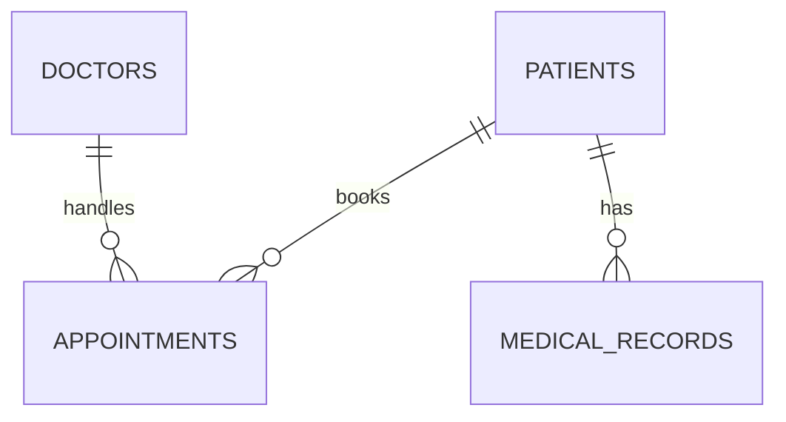

# Hospital-Management-System
Hospital Management system using MySQL
Hospital Management System

About the Project

The Hospital Management System is a beginner-friendly SQL project developed using MySQL. It helps manage basic hospital information, including patients, doctors, appointments, and medical records.

Technologies Used

- MySQL
- SQL

Database Tables

1. Patients – Stores patient details.
2. Doctors – Stores doctor details and specializations.
3. Appointments – Stores appointment information.
4. Medical_Records – Stores patient diagnosis and treatment details.

Features

- Create and manage hospital database tables.
- Store patient and doctor information.
- Maintain appointment details.
- Store medical records.
- Retrieve information using SQL queries.
- Use JOIN and aggregate functions.

SQL Concepts Used

- CREATE DATABASE
- CREATE TABLE
- INSERT INTO
- SELECT
- WHERE
- COUNT()
- INNER JOIN
- PRIMARY KEY
- FOREIGN KEY

Project Files

- "database.sql" – Creates the database and tables.
- "insert_data.sql" – Inserts sample records.
- "queries.sql" – Contains SQL queries.
## Entity Relationship Diagram

erDiagram
    PATIENTS ||--o{ APPOINTMENTS : books
    DOCTORS ||--o{ APPOINTMENTS : handles
    PATIENTS ||--o{ MEDICAL_RECORDS : has

    PATIENTS {
        INT patient_id PK
        VARCHAR patient_name
        INT age
        VARCHAR gender
        VARCHAR phone
    }

    DOCTORS {
        INT doctor_id PK
        VARCHAR doctor_name
        VARCHAR specialization
        VARCHAR phone
    }

    APPOINTMENTS {
        INT appointment_id PK
        INT patient_id FK
        INT doctor_id FK
        DATE appointment_date
    }

    MEDICAL_RECORDS {
        INT record_id PK
        INT patient_id FK
        VARCHAR diagnosis
        VARCHAR treatment
        DATE record_date
    }
